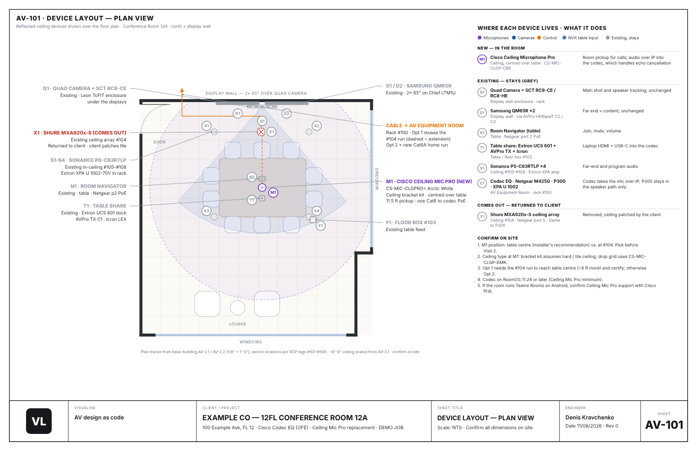
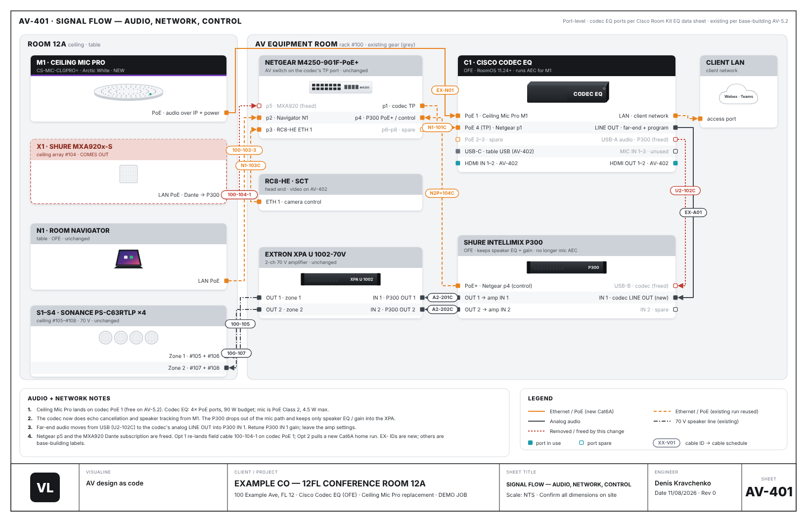
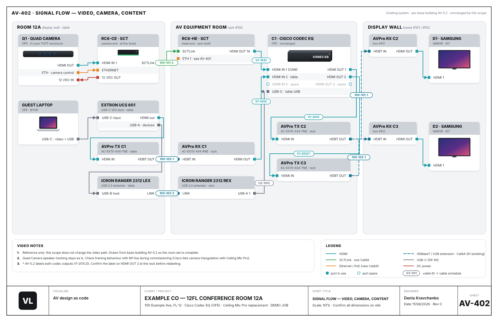
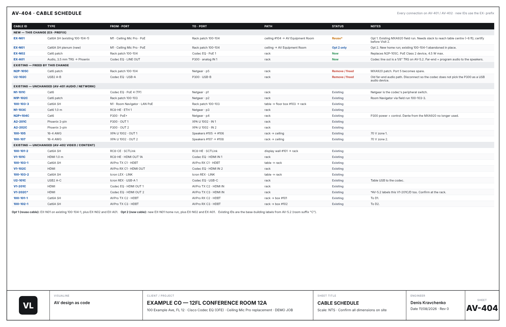
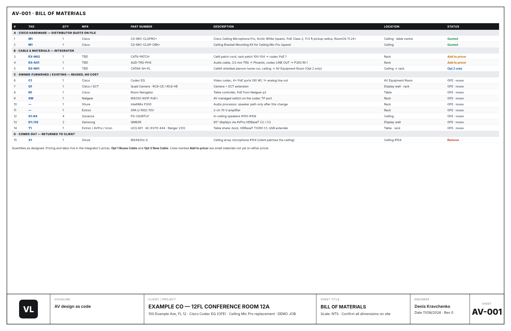

# VisuaLine

**AV design as code.** One Python file describes a room. The engine turns it into a full installer drawing set — bill of materials, plan view, port-level signal flow, cable schedule — as a 17×11 PDF.

Hand-drafting a set like this in AutoCAD took my team at least a week per job. VisuaLine builds it in minutes, every job comes out in the same style, and the same rules are checked on every build.

This repo is a showcase. The engine itself is private. Everything below comes from a **fictional demo job** (Example Co, Conference Room 12A): a ceiling-mic replacement in a two-display Cisco room.

---

## The drawing set

### AV-101 · Device layout — plan view
Room to scale, every device tagged by category, camera and mic coverage clipped to the walls, callouts that space themselves so they never collide, and a "where each device lives / what it does" panel.

### AV-401 · Signal flow — audio, network, control
Port-level. Every card is a real device with its real ports; filled squares are in use, hollow are spare. Wire color and dash pattern mean signal type. Every connection carries a cable ID that ties to the schedule. New gear is dark, existing owner-furnished gear is grey, gear coming out is red.

### AV-402 · Signal flow — video, camera, content

### AV-404 · Cable schedule
Every wire on the signal-flow sheets, with ID, type, both ends, path and status.

### AV-001 · Bill of materials
New hardware, cable and materials, owner-furnished gear that stays, and gear that comes out.

---

## What's behind it

- **One source of truth.** The BOM, plan, signal flow and cable schedule are generated from the same job data, so they can't disagree with each other.
- **Rules that block the build.** Rules learned from real field corrections, each tied to an automated check. The drawing BOM must match the client quote part for part. Every device on the BOM must appear on a signal-flow sheet. Wall-mounted devices are tested against the scanned walls. The network pull schedule must tie out to the network owner's totals. A failed check stops delivery.
- **No specs from memory.** Device power, PoE and network data come from a verified library, each entry with its vendor source and check date.
- **Scan-first.** Jobs start from a LiDAR scan of the space. The scan feeds measurements; the client sees a clean modeled room.
- **Photoreal 3D.** Blender Cycles renders and single-file interactive 3D room viewers that open anywhere, including from an iMessage or email attachment.
- **LLM tooling.** The engine is exposed as tools to a local model (Gemma on Ollama) and as an MCP server. The model builds and checks drawing sets, and looks up specs only from the verified library: not found means "not verified", never a guess.
- **Design to operations.** A machine-readable BOM export (`visualine-export/1`) feeds [RoomWatch](https://github.com/iwastimelessonce/roomwatch-showcase), my fleet-health monitor, so the monitoring inventory comes straight from the design.

Built with Claude.

---

Walkthrough of the engine on request.

**Denis Kravchenko** · [LinkedIn](https://www.linkedin.com/in/denis-kravchenko-30804b6b) · [RoomWatch](https://github.com/iwastimelessonce/roomwatch-showcase)

© 2026 Denis Kravchenko. All rights reserved.
